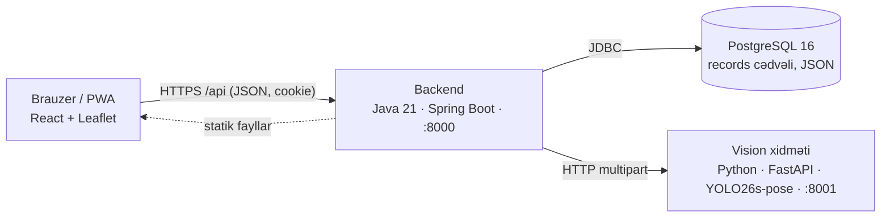

# BakuYolOu — gediş planı və nəqliyyatın rəqəmsal əkizi

Digital Azerbaijan Challenge 2026 üçün Azərbaycan dilində işlək demo: sərnişin üçün gediş planı, canlı avtobus xəritəsi və doluluq; operator üçün rəqəmsal əkiz, GPS sıxlıq xəritəsi, rezerv tövsiyələri və YOLO26 pose kamera analizi. Veb və quraşdırıla bilən tətbiq (PWA).

## Sistem arxitekturası



| Qat | Texnologiya | Vəzifə |
|---|---|---|
| **Frontend** (`frontend/`) | React 18, Vite, Leaflet, PWA | Rol seçimi, sərnişin (gediş planı, xəritə, gəlişlər, STOP, sıxlıq bildirişi), operator (rəqəmsal əkiz, park, sıxlıq xəritəsi, xəbərdarlıqlar, YOLO). Build Spring Boot-un statik fayllarına daxil edilir. |
| **Backend** (`backend/`) | Java 21, Spring Boot 3.4, Spring JDBC | REST API (`/api/*`, OpenAPI `/docs`), demo rol sessiyası, sintetik hərəkət/ETA/doluluq, gediş axtarışı, twin simulyasiyası, sıxlıq və xəbərdarlıq xidməti, vision proxy, planlaşdırılmış təmizləmə. |
| **DB** | PostgreSQL 16 | Bütün qeydlər bir `records(id, kind, data JSON)` cədvəlində: bus, route_state, event, report, session, stop, scenario, action, alert, vision. Sxem başlanğıcda yaranır, demo park idempotent seed olunur. |
| **Vision** (`vision/`) | Python 3.11, FastAPI, Ultralytics YOLO26s-pose, ByteTrack | Şəkil/videoda insan aşkarlama, oturur/ayaqüstə təxmini, videoda izləmə. Yalnız backend ona müraciət edir; port xaricə açılmır. |

**Əsas API axını:** `GET /api/routes` → kataloq · `GET /api/fleet?route&stop&dir` → canlı avtobuslar · `GET /api/journeys?from&to` → gediş variantları · `POST /api/reports` → sıxlıq bildirişi (doluluğu dəyişir, lazım olsa xəbərdarlıq yaradır) · `GET /api/density` → GPS sıxlıq xanaları · `GET /api/alerts` + `POST /api/alerts/{id}/dispatch` → rezerv tövsiyəsi və icrası · `POST /api/twin/preview` + `/apply` → simulyasiya · `POST /api/vision/detect|video` → YOLO. Tam siyahı: [docs/TECHNICAL.md](docs/TECHNICAL.md) və `/docs`.

## Docker runtime (tövsiyə olunur)

Tələb: Docker Desktop (Compose v2.24+). İlk dəfə `.env.example` faylını `.env` adı ilə kopyalayın və `POSTGRES_PASSWORD`, `OPERATOR_KEY` üçün təsadüfi dəyərlər yazın. Mövcud `.env` faylını dəyişməyin.

```powershell
Copy-Item .env.example .env      # yalnız ilk dəfə, sonra dəyərləri dəyişin
docker compose up -d --build
docker compose ps                # db, vision, app "healthy" olmalıdır
```

- Tətbiq: http://localhost:8000
- API sənədləri: http://localhost:8000/docs
- Sağlamlıq: http://localhost:8000/api/health
- YOLO sağlamlığı: http://localhost:8000/api/vision/health

İlk build internetdən Java/Node/Python paketlərini, CPU PyTorch, YOLO26 çəkilərini və test şəklini endirir (bir neçə dəqiqə). Sonrakı build-lər keşdən istifadə edir. Dayandırmaq: `docker compose down` (məlumat `transit_data` volume-da qalır; `down -v` bazanı silir). Loglar: `docker compose logs -f app`.

## Lokal runtime (Docker-siz inkişaf)

Tələblər: Java 21 + Maven 3.9, Node.js 22, Python 3.11, PostgreSQL 16 (və ya yalnız DB üçün Docker). Hər komponent ayrıca terminalda işləyir. Nümunələr PowerShell üçündür.

**1. PostgreSQL**

```powershell
# Variant A: yalnız DB Docker-də, localhost:5432-də
docker compose -f compose.yaml -f compose.local.yaml up -d db
# Variant B: quraşdırılmış PostgreSQL
psql -U postgres -c "CREATE USER transit PASSWORD 'parol'; CREATE DATABASE transit OWNER transit;"
```

**2. Vision xidməti** (`vision/`, port 8001)

```powershell
cd vision
python -m venv .venv; .\.venv\Scripts\Activate.ps1
pip install torch==2.6.0 torchvision==0.21.0 --index-url https://download.pytorch.org/whl/cpu
pip install -r requirements.txt
$env:MODELS_DIR = "$PWD\models"; New-Item -ItemType Directory -Force $env:MODELS_DIR | Out-Null
Invoke-WebRequest https://github.com/ultralytics/assets/releases/download/v8.4.0/yolo26s-pose.pt -OutFile "$env:MODELS_DIR\yolo26s-pose.pt"
Invoke-WebRequest https://ultralytics.com/images/bus.jpg -OutFile "$env:MODELS_DIR\bus.jpg"
python make_sample.py
uvicorn service:app --port 8001
```

**3. Backend** (`backend/`, port 8000)

```powershell
cd backend
$env:DATABASE_URL = "jdbc:postgresql://localhost:5432/transit"
$env:DATABASE_USER = "transit"
$env:POSTGRES_PASSWORD = "parol"          # .env-dəki dəyər
$env:OPERATOR_KEY = "lokal-operator-acari"
$env:DEMO_ACCESS_ENABLED = "true"
$env:VISION_URL = "http://localhost:8001"
mvn spring-boot:run
```

**4. Frontend** (`frontend/`, port 5173, hot reload)

```powershell
cd frontend
npm ci
npm run dev
```

http://localhost:5173 açın. Vite `/api` sorğularını `http://localhost:8000`-ə yönləndirir. Docker-dəki `app` konteyneri işləyirsə əvvəlcə onu dayandırın (`docker compose stop app`), çünki 8000 portu eynidir.

## Deploy (sürətli yol)

Vaxt az olduqda tövsiyə: **bir Linux VM + Docker Compose + Caddy (avtomatik HTTPS)**. Kod dəyişmədən işləyir, vision xidməti (PyTorch) üçün serverless platformalardan daha etibarlıdır.

1. VM: Ubuntu 24.04, **2 vCPU / 4 GB RAM**, 30 GB disk (Hetzner CX22, DigitalOcean, Azure B2s və s.). 80 və 443 portlarını açın.
2. Domen və ya subdomenin A qeydini VM-in IP-sinə yönləndirin (məs. `bakuyolou.example.az`).
3. VM-də Docker quraşdırın: `curl -fsSL https://get.docker.com | sh`.
4. Kodu çəkin, `.env` yaradın (`POSTGRES_PASSWORD`, `OPERATOR_KEY`, `DOMAIN=bakuyolou.example.az`).
5. İşə salın:

```bash
docker compose -f compose.yaml -f compose.prod.yaml up -d --build
```

Caddy Let's Encrypt sertifikatını özü alır; tətbiq `https://DOMAIN` ünvanında açılır, PWA quraşdırılması və Secure cookie işləyir. App portu (8000) xaricə açılmır, konteynerlər restartdan sonra özü qalxır. Yeniləmə: `git pull && docker compose -f compose.yaml -f compose.prod.yaml up -d --build`.

Domen yoxdursa: Cloudflare Tunnel (`cloudflared tunnel --url http://localhost:8000`) müvəqqəti HTTPS ünvanı verir. İctimai deploy-da demo rol girişi açıqdır; münsiflərə göstərmək üçün yetərlidir, real istifadədə autentifikasiya lazımdır.

## Giriş və demo

İlk ekran iki seçim verir: **Sərnişin** və **Operator**. Qeydiyyat və parol yoxdur. Compose `DEMO_ACCESS_ENABLED=true` qurur. Rol serverin yaratdığı 4 saatlıq HttpOnly/SameSite cookie ilə saxlanır; səhifəni yeniləmək rolu saxlayır, tətbiq serverinin restartı sessiyanı bitirir.

Bu rol seçimi şəxsiyyət yoxlaması deyil. İctimai istehsal mühitində demo girişini söndürün və ayrıca həqiqi autentifikasiya tətbiq edin. Bütün operator API-ləri (twin və YOLO daxil) cookie olmadan `X-Operator-Key` başlığı ilə `.env`-dəki `OPERATOR_KEY`-i də qəbul edir; demo girişi söndürüləndə inteqrasiyalar bu yolla işləyir. Bu açar frontend-ə ötürülmür. Demo girişi aktiv olanda sərnişin əməliyyatları (reysə qoşulma, bildiriş) rol seçimi tələb edir; girişə IP üzrə dəqiqədə 30 cəhd limiti qoyulub.

### Sərnişin

1. **Gediş planla**: dayanacaqları siyahıdan seçin və ya xəritədə dayanacağa toxunub **Buradan / Buraya** basın. Hər iki istiqamət və bir köçürməli gedişlər təklif olunur (ümumi vaxt, ilk avtobus, köçürmə gözləməsi).
2. 10 demo xətt, 35 dayanacaq, ilk qurulumda 45 avtobus. Xəritədə avtobuslar 🚌 markerlə, doluluq rəngi ilə göstərilir və 4 saniyədə bir hamar hərəkət edir.
3. Gəlişlər seçilmiş dayanacaq və istiqamət üzrə ETA ilə sıralanır.
4. **Boş / Normal / Dolu / Çox dolu** bildirişi 10 dəqiqə ərzində avtobusun göstərilən doluluğunu dərhal dəyişir. Hər istifadəçinin hər avtobus üçün bir aktiv bildirişi var; yeni seçim əvvəlkini əvəz edir.
5. Reysə qoşulun və STOP göndərin; reys səhifə yenilənəndə də qalır.
6. Sol menyu (mobildə alt menyu) səhifəni sürüşdürdükcə aktiv bölməni göstərir.

### Operator / digital twin

1. Xətti, dayanacağı və istiqaməti seçin; tələb əmsalı, əlavə gecikmə və 5–60 dəqiqəlik pəncərə qurun.
2. **Simulyasiyanı hesabla** cari vəziyyətin surətini saxlayır; parkı dəyişmir.
3. Rezerv avtobus (60 dəqiqə xəttdə qalır), siqnal prioriteti (15 dəqiqəlik, təkrar tətbiq yalnız müddəti uzadır) və yük bölgüsünü müqayisə edin.
4. **Demo parkına tətbiq et** seçilmiş həlli parka və qərar jurnalına yazır. 5 dəqiqədən köhnə və ya dəyişmiş parka aid ssenari rədd edilir.
5. Avtobus parkı cədvəli bütün avtobusları, ETA, doluluq və sərnişin bildirişlərini göstərir.
6. YOLO26s-pose: **Şəkil** (maks. 8 MB) və ya **Video** (MP4/WebM/MOV, maks. 50 MB, ilk 30 saniyə). Hər insan üçün **oturur / ayaqüstə / bilinmir** təxmini verilir (çiyin–omba–diz bucağı; əmin olmayanda “bilinmir”). Video saniyədə ~3 kadr analiz edilir, ByteTrack eyni insanı kadrlar arasında izləyir; çərçivələr video oynadıqca üzərində göstərilir. Uzun lokal yazılar üçün: `python vision/bus_yolo26.py video.mp4 --capacity 80` (annotasiyalı MP4 + CSV).
7. **Sıxlıq xəritəsi**: bütün avtobusların GPS mövqeyi ~400 m xanalara toplanır; dairənin ölçüsü sərnişin sayı, rəngi doluluqdur (≥85% yüksək). Avtobus sayğacı ≥95% göstərəndə və ya sərnişinlər Dolu/Çox dolu bildirəndə **“Əlavə rezerv avtobus ayrılsın”** xəbərdarlığı yaranır (xətt başına bir açıq xəbərdarlıq, 15 dəqiqə təkrar yox); **Rezerv ayır** düyməsi rezerv avtobusu dərhal xəttə çıxarır və qərar jurnalına yazır.
8. Sərnişinin STOP sorğusunu təsdiqləyin, demo yol hadisəsi yaradın və bağlayın.

### Tətbiq kimi quraşdırma (PWA)

BakuYolOu quraşdırıla bilən veb tətbiqdir. Chrome/Edge-də ünvan sətrindəki quraşdır ikonu və ya menyudakı **Tətbiqi quraşdır** düyməsi, Android-də **Ana ekrana əlavə et**, iOS Safari-də **Paylaş → Ana ekrana əlavə et**. Brauzerlər quraşdırmanı yalnız `localhost` və ya HTTPS üzərindən icazə verir; telefondan LAN IP ilə açıldıqda tətbiq işləyir, amma quraşdırma üçün HTTPS lazımdır.

## Məlumatın mənası

Bakı məkan adları və təxmini koordinatlar istifadə edilir. Marşrut nömrələri, dayanacaq ardıcıllığı, GPS hərəkəti, ETA, doluluq və sərnişin tələbi **demo/sintetikdir**; AYNA və ya 2GIS ilə inteqrasiya yoxdur. 2GIS-in ictimai nəqliyyat API-si kommersiya açarı tələb edir və məlumatın açarsız toplanması istifadə şərtlərinə ziddir; açar əldə edilərsə `FleetService`/`RouteCatalog` bir adapterlə əvəz oluna bilər. Xəritə xətləri dayanacaqlar arası düz xətlərdir.

YOLO real inferens edir, amma standart nümunələr avtobusun xaricində çəkilmiş Ultralytics şəklidir (video nümunə həmin şəkil üzərində süni kamera hərəkətidir). Görünən insan sayı salonun ümumi doluluğu deyil. 2D salonda mövqelər sintetikdir. Yüklənən şəkil və videolar saxlanmır; yalnız aşkarlama metadatası PostgreSQL-ə yazılır. Köhnə müvəqqəti qeydlər (rezerv avtobuslar, ssenarilər, bildirişlər) avtomatik təmizlənir.

## Test

```powershell
.\scripts\verify.ps1
```

Backend testləri ayrıca `transit_test` bazasında tranzaksiyaların rollback-i ilə işləyir. Playwright testləri ayrıca `app-qa` konteynerində, hər dəfə yenidən yaradılan `transit_e2e` bazasına qarşı işləyir; demo bazası dəyişmir. Ekran görüntüləri `artifacts/ui/` qovluğundadır.

Linux backend testləri: `./scripts/test.sh`. Yalnız brauzer testləri:

```powershell
docker compose exec -T db createdb -U transit transit_e2e   # bir dəfə
docker compose -f compose.yaml -f compose.qa.yaml run --rm --build ui-test
```

Məlumat `transit_data` volume-da saxlanır. Bazanı qorumaq üçün `docker compose down` istifadə edin; `down -v` bazanı silir.

Arxitektura və model: [docs/TECHNICAL.md](docs/TECHNICAL.md). Test nəticələri: [docs/QA.md](docs/QA.md). AI bəyannaməsi və təqdimat qeydi: [docs/SUBMISSION.txt](docs/SUBMISSION.txt).
