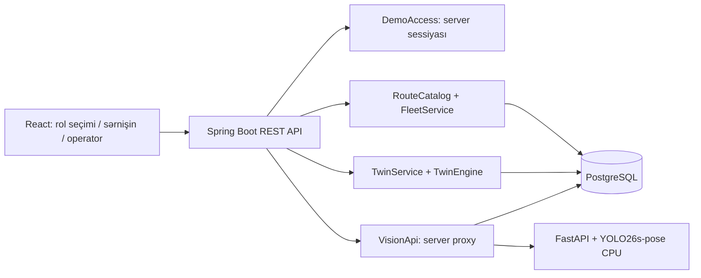

# Texniki izah və arxitektura

## Komponentlər

Frontend `App` sessiya və şəbəkə vəziyyətini idarə edir; `Passenger`, `Operator`, `TransitMap`, `Cabin` məsuliyyətlərinə görə ayrılıb. `api.js` vahid xəta işlənməsi və cookie göndərilməsini təmin edir. API açarları brauzerə ötürülmür.

Backend mövcud crowdsourcing API-sini saxlayır. Yeni transport controller giriş validasiyasını, xidmətlər isə biznes qaydalarını icra edir. `TwinEngine` I/O-dan asılı olmayan deterministik hesablayıcıdır. `Store` parametrli SQL ilə record repository-dir. JSON record modeli prototipə çeviklik verir; istehsalda normallaşdırılmış cədvəllər, schema migrasiyaları və daha sərt DB constraint-ləri tələb olunur.

Seed iki mərhələlidir: əvvəl ilkin məlumat, sonra idempotent park genişləndirilməsi. Mövcud bazanın məlumatı silinmir. Hər xətt üçün unikal demo vehicle kodları və route_state yaradılır. Yeni başlanğıcda 10 xətt, 35 dayanacaq, 45 avtobus və 2 hadisə var. `Maintenance` 5 dəqiqədən bir vaxtı keçmiş rezerv avtobusları, 1 gündən köhnə ssenari/bildiriş/sessiya/STOP və 7 gündən köhnə YOLO qeydlərini silir. `Store.get` birbaşa id üzrə SQL sorğusudur.

## Rol və endpoint sərhədləri

`POST /api/access {role: passenger|operator}` yalnız `DEMO_ACCESS_ENABLED=true` olduqda açıqdır. Təsadüfi sessiya tokeni server yaddaşında saxlanır, HttpOnly/SameSite=Strict cookie 4 saat yaşayır. Bu demo rol seçimi autentifikasiya iddiası daşımır. Operator əməliyyatları serverdə rol ilə yoxlanılır; passenger cookie-si kifayət etmir. `DELETE /api/access` tokeni ləğv edir.

| Endpoint | Məqsəd |
|---|---|
| GET /api/routes | Marşrut və dayanacaq kataloqu |
| GET /api/journeys?from=28may&to=ag | Hər iki istiqamətdə birbaşa və bir köçürməli gedişlər, ümumi vaxta görə |
| GET /api/fleet?route=125&stop=28may&dir=f | Xəttin bütün avtobusları, seçilmiş istiqamət üzrə ETA və doluluq |
| GET /api/events | Bütün aktiv hadisələr |
| POST /api/twin/preview | Validasiya edilmiş fərziyyələr ilə 3 həllin müqayisəsi |
| POST /api/twin/{id}/apply | Versiyalı, tranzaksiyalı, idempotent tətbiq |
| POST /api/vision/demo?bus_id=… | Həqiqi YOLO26 pose inferensi, məlum nümunə şəklində |
| POST /api/vision/detect?bus_id=… | Multipart şəkildən insan aşkarlama |
| POST /api/vision/video?bus_id=…, /demo-video | Videoda kadr-kadr aşkarlama + ByteTrack izləmə |
| GET /api/vision/latest/{bus} | Son aşkarlama metadatası |
| GET /api/vision/health | YOLO xidmətinin hazırlığı |
| /api/join, /stop, /stop-status (X-Ride-Token başlığı), /reports | Reys, STOP və crowdsourcing axını |
| /api/operator, /stops/{id}/ack, /events, /telemetry/{id}, /actions | Əməliyyat və qərar jurnalı |

Tam schema `/docs` və `/v3/api-docs` endpointlərindədir. Naməlum input sahələri rədd edilir; qeyri-düzgün body 422, icazəsiz əməliyyat 403, köhnə ssenari 409 qaytarır. YOLO əlçatmaz olduqda 503 göstərilir, sintetik nəticə ilə əvəz edilmir.

## Hərəkət, ETA və doluluq

Hər avtobus son dayanacağa qədər gedib geri qayıdır; dövr = 2 × birtərəfli səfər vaxtı. Server vaxtı + avtobusun fazası dövrdə mövqe verir, qonşu iki dayanacaq arasında interpolasiya olunur. ETA seçilmiş dayanacağın seçilmiş istiqamətdəki mövqeyinə qalan dövr məsafəsidir; aktiv hadisələrin gecikməsi əlavə olunur, aktiv siqnal prioriteti (15 dəqiqə, sabit 3 dəqiqə, yığılmır) çıxılır. Operator telemetriyası 10 dəqiqə sayğacı, GPS 2 dəqiqə mövqeyi əvəz edir.

Sintetik sayğac marşrutun ortasında artır, son dayanacaqlara yaxın azalır. Son 10 dəqiqənin sərnişin bildirişləri (Boş 15%, Normal 45%, Dolu 80%, Çox dolu 100%) sayğacla qarışdırılır; çəki 1 bildirişdə 0.4, hər əlavə bildirişlə artır, maksimum 0.7. Bir istifadəçinin hər avtobus üçün bir aktiv bildirişi saxlanır; istifadəçi demo sessiyası (yoxdursa client id + IP) üzrə hash ilə tanınır, dəqiqədə 12 bildiriş limiti var.

Gediş axtarışı eyni xətdə hər iki istiqaməti və iki xətt arasında bir köçürməni yoxlayır. Köçürmədə ikinci xəttin ilk avtobusu gəlişdən ən azı 2 dəqiqə sonra götürülür. Bu real yol routing-i deyil.

## Digital twin modeli

Preview seçilmiş bir dayanacaqda ilkin növbəni `(35 + hadisə tələbi) × tələb əmsalı`, dəqiqəlik gəlişi `round(3 × əmsal)` kimi götürür. Hər dəqiqədə yeni tələb növbəyə əlavə olunur; həmin dəqiqə çatan avtobus boş tutum qədər sərnişin götürür. Hər avtobus yalnız bir dəfə modelə daxil edilir. Sərnişin enməsi nəzərə alınmır.

Müdaxilələr:

- Rezerv: 4-cü dəqiqədə 80 əlavə boş yer; əməliyyatda 60 dəqiqəlik yeni demo avtobus yaradır (xətt başına maksimum 4 əlavə).
- Prioritet: hər ETA-nı 3 dəqiqə azaldır, minimum 1 dəqiqə. Tətbiq `route_state.priority_until`-u 15 dəqiqə sonraya qoyur; artıq aktivdirsə preview əlavə qazanc göstərmir.
- Yük bölgüsü: ilk gəlişin boş yerini maksimum 10 artırır, sonuncunun boş yerini eyni qədər azaldır. Ümumi tutum və sərnişin sayı qorunur. Demo tətbiqində sərnişin sayları iki avtobus arasında daşınır.

Çıxışlar: qarşılanan və qarşılanmayan tələb, xidmət faizi, dəqiqəlik növbə qrafiki, pəncərə daxilində bütün tələbin keçirdiyi orta növbə vaxtı. Son metrik tam səfər gözləməsi deyil; pəncərənin sonunda qalan sərnişinlərin gələcək gözləməsi daxil deyil. Variantlar ən az gözləməyə görə sıralanır; maliyyə və siqnal infrastrukturu üzrə optimallaşdırma yoxdur.

Hər preview snapshot, baseline, alternativlər və fərziyyələri bazaya yazır. Apply zamanı ssenari və route_state DB row lock ilə kilidlənir. Version, park/hadisə fingerprint-i və 5 dəqiqəlik vaxt pəncərəsi yoxlanır. Eyni həllin təkrar tətbiqi əvvəlki nəticəni qaytarır; başqa həllə keçmək üçün yeni preview lazımdır. Qərar jurnalı ayrıca yazılır. Xarici telemetriya yazıları ilə tam çoxinstanslı serializasiya istehsal mərhələsi üçün əlavə işdir.

## YOLO və 2D salon

YOLO26s-pose çəkiləri və nümunə şəkil konteyner build-ində endirilir və SHA-256 ilə yoxlanılır, Python paketləri dəqiq versiyalara bağlanıb; CPU inferensində yalnız `person` sinfi və 0.35 confidence həddi istifadə edilir. Nəticədə normallaşdırılmış bounding box, confidence, görünən insan sayı və müddət qaytarılır. Xidmətin bir model instansı lock ilə qorunur. Fayl həddi 8 MB, şəkil həddi 16 MP-dir. Java proxy timeout və xəta cavablarını idarə edir.

2D salon 30 oturacaq və 50 ayaqüstə yer tutumunu göstərir. Bu sxem telemetriya saylarının vizualizasiyasıdır; piksel koordinatından yer proyeksiyası deyil. Test şəkli avtobusun xaricini göstərir. Ümumi real doluluq üçün daxili kamera, giriş/çıxış sayımı, tracking və kalibrasiya tələb edilir. Video: fayl müvəqqəti fayla yazılır, saniyədə ~3 kadr (maks. 90 kadr = 30 s) seçilir, hər video üçün ayrı model nüsxəsində ByteTrack ilə izlənir; cavabda hər kadrın vaxtı, çərçivələri və track id-ləri, maksimum/orta görünən və fərqli izlənən insan sayı var. Bazaya yalnız kadr başına say yazılır. Nümunə video build zamanı bus.jpg üzərində VP8/WebM kimi yaradılır. Canlı kamera axını inteqrasiya edilməyib.

## Referanslar və məlumat mənbələri

- mygov xidmət qruplaşdırması: https://idda.az/en/news/new-functionality-in-the-mygov-app-information-and-services-have-been-combined-under-unified-categories
- AYNA MaaS xəritə və avtobus axını: https://ayna.gov.az/az/news/ayna-maasda-funksional-yenilikler-tetbiq-edilib-1066
- Map AYNA: https://map.ayna.gov.az/ — ictimai referans; bu layihə onun daxili API-sini istifadə etmir.
- Xəritə plitələri: OpenStreetMap; attribution UI-də saxlanır. Şriftlər (DM Sans, Manrope) @fontsource ilə tətbiqə daxildir.
- 2GIS: ictimai nəqliyyat API-si açar tələb edir; bu layihə 2GIS məlumatı istifadə etmir.
- Həqiqi inferens nümunəsi: https://ultralytics.com/images/bus.jpg
- Model: https://github.com/ultralytics/assets/releases/download/v8.3.0/yolo11n.pt

UI referanslardan xidmət kartları, aydın rol seçimi və xəritə üzərində marşrut izləmə yanaşmasını götürür; dövlət tətbiqi və ya AYNA ilə rəsmi əlaqə iddiası yoxdur.

## Əlavə istehsal işi

OIDC/RBAC, HTTPS və Secure cookies, davamlı sessiya store-u, Flyway migrasiyaları, server tərəfli həqiqi GPS/GTFS adapteri, geospatial routing, kənar servis müşahidəsi, media consent və retention, tam telemetriya tarixçəsi, ehtimal intervalı və empirik model kalibrasiyası. İndiki demo kiçik park üçün bütöv JSON rekordlarını oxuyur; böyük həcmdə indekslənmiş sorğular və ayrıca cədvəllər tələb olunur.

## Tətbiq (PWA)

`manifest.json`, ikonlar və `sw.js` service worker tətbiqi quraşdırıla bilən edir. Service worker naviqasiya üçün network-first, hash-li `/assets/*` üçün cache-first işləyir; `/api` heç vaxt keşlənmir. Quraşdırma localhost və ya HTTPS tələb edir.

## YOLO26 pose və duruş təxmini

Model YOLO11n-dən YOLO26s-pose-a keçirildi. `bus.jpg` üzərində ölçü (CPU): YOLO11n 4 insan, ən zəif confidence 0.62, 29 ms; YOLO26s-pose 4 insan, ən zəif 0.72, 56 ms, üstəlik 17 açar nöqtə. Video nümunəsi 18 kadrda ~1.5 s çəkir.

`vision/posture.py`: çiyin, omba və diz nöqtələri (confidence ≥ 0.52) görünəndə ombadakı bucaq 60–123° oturur, 151–180° ayaqüstə sayılır, qalan hər şey “bilinmir”. Bədən və bud seqmenti insanın çərçivə hündürlüyünün ən azı 12%-i olmalıdır; bu, nəticəni video həllindən asılı etmir (ilkin skriptdə mütləq piksel həddi var idi). Önə baxan oturan insanda bud qısalır və nəticə “bilinmir” olur — bu qəsdəndir. Videoda hər izlənən insan üçün klip üzrə ən çox görünən bilinən duruş götürülür. Qaydalar build zamanı `test_posture.py` ilə yoxlanılır. Real salon kamerasında kalibrasiya və etiketli məlumatla dəqiqlik ölçülməyib.

`vision/bus_yolo26.py` eyni model və qaydalarla uzun videonu lokal analiz edir: annotasiyalı MP4 və saniyəlik CSV. İlkin versiyadan fərqlər: nisbi seqment həddi, saxta track id yoxdur, çıxış FPS mənbədən böyük olmur (video sürətlənmir), NaN FPS qorunur, standart conf 0.35 və imgsz 640.
